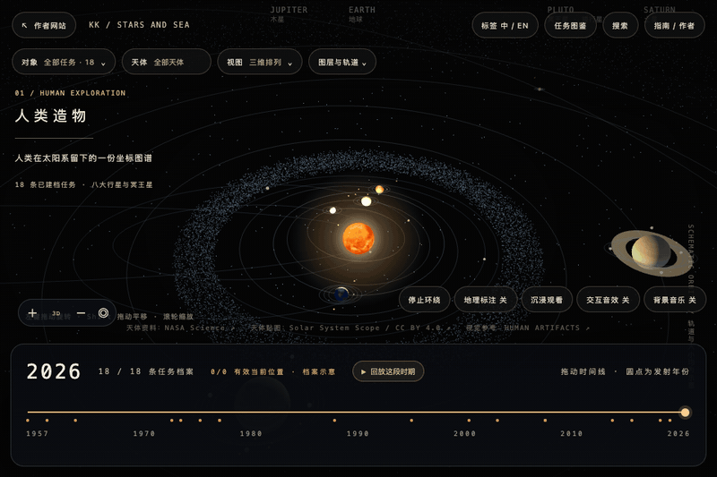
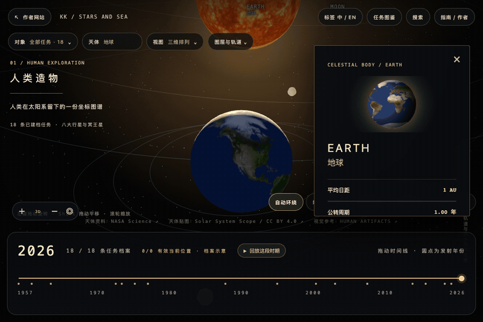
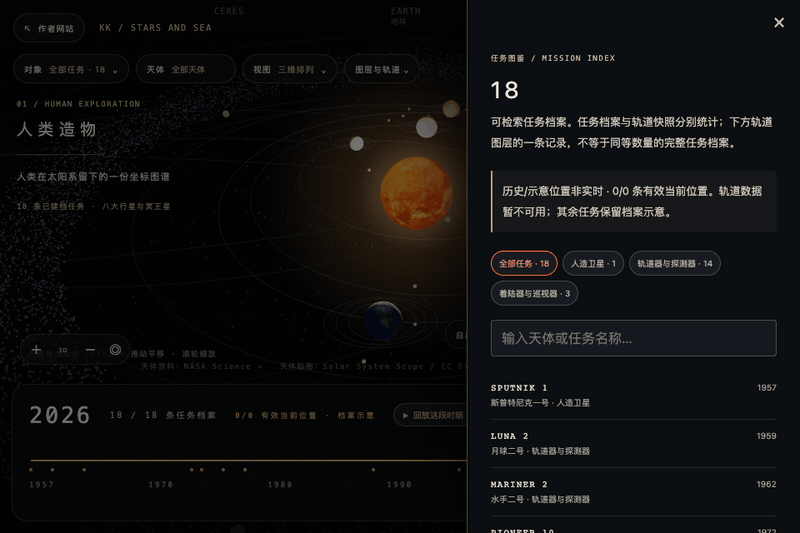
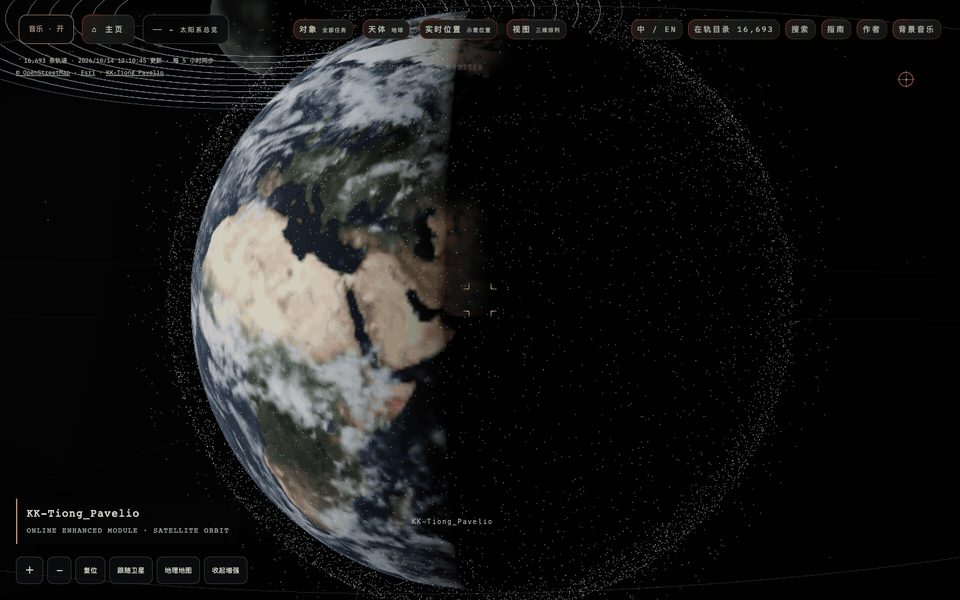
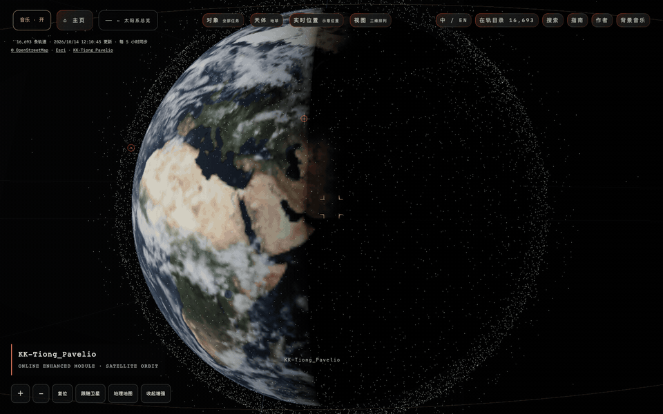
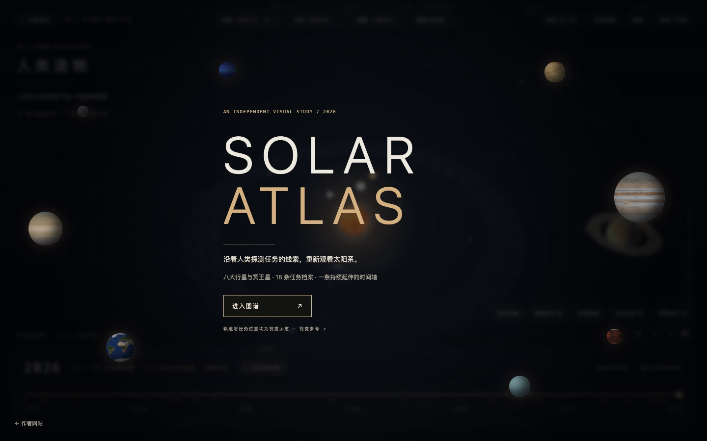
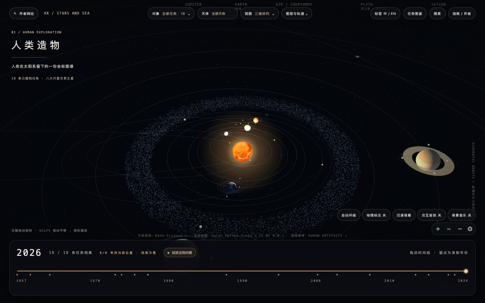
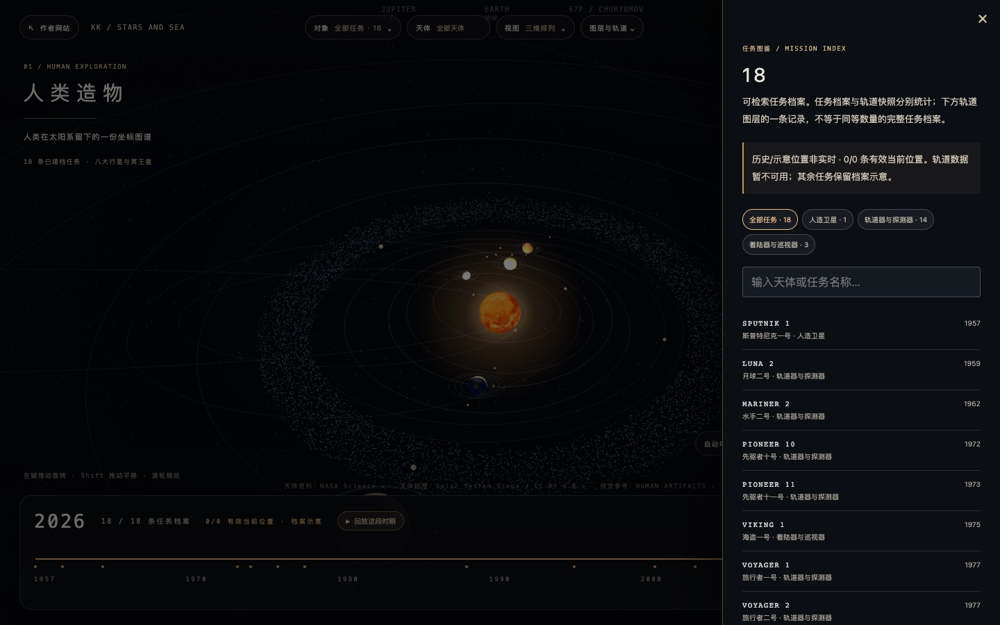
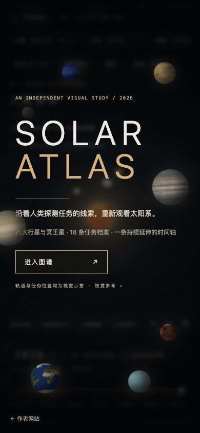

# STARS AND SEA · Solar Atlas Core

由 [KK-Tiong_Pavelio](https://ichxjz.com) 制作的独立太阳系图谱核心。使用 React、Three.js 和 Web Worker 呈现可交互的天体、任务标记与时间轴，可在本地直接运行。

这个仓库收录 9 个天体、18 条选录任务档案、任务搜索、镜头与图层控制，以及桌面和手机布局。轨道位置、标记大小和部分小天体路径用于视觉说明，不适合导航或科研计算。

## 黑色主题动图 / Black theme demos

以下 GIF 均录制自本仓库的实际浏览器操作（800px、12fps），没有使用线上私有模块。

| 太阳系总览 / Overview | 地球聚焦 / Earth focus |
| :---: | :---: |
|  |  |



## 线上增强版卫星演示 / Online enhanced satellite demos

以下两张 GIF 录制自[线上增强模块](https://ichxjz.com/KK-Tiong_Pavelio)的真实浏览器操作，包含 `KK-Tiong_Pavelio` 录制署名：点选一颗卫星生成一条运动轨迹，继续点选可同时查看多条轨迹。位置依据公开轨道要素推算，非实时遥测。

**这些增强功能不包含在本仓库的独立核心中。** 本仓库仅收录其演示 GIF，没有加入线上前端、GP 快照或私人后台。前三张黑色主题 GIF 仍对应本仓库实际提供的功能。

| 点选卫星与轨迹 / Select a satellite | 多颗卫星运动轨迹 / Multiple orbits |
| :---: | :---: |
|  |  |

## 0.2.0 更新 / Changes

- 首次有效绘制与轨道 Worker 就绪后即可进入，高清贴图后台加载；加载失败时保留基础色彩，并明确显示失败数，不将失败计为完成。
- 触屏轻触在松手位置重新拾取；拖动和双指操作不会误开天体资料。
- 黑色主题界面，保留真实天体贴图的原有颜色。提供桌面与移动端实际截图。

## 截图 / Screenshots

| 进入图谱 / Opening | 交互图谱 / Atlas |
| :---: | :---: |
|  |  |

| 任务图鉴 / Mission index | 手机入口 / Mobile opening |
| :---: | :---: |
|  |  |

## 本地运行 / Run locally

需要 Node.js 20.19 或更新版本。

```bash
npm ci
npm run dev
```

打开终端显示的本地地址。运行 `npm run build` 构建，`npm run preview` 检查生产构建。

## 项目范围与许可 / Scope and licensing

这是可独立运行的原创核心版。[线上 STARS AND SEA 页面](https://ichxjz.com/KK-Tiong_Pavelio)使用尚未确认再分发许可的第三方压缩前端，因此线上页面的 206 条档案、持续更新的 GP 轨道快照、任务照片、音乐和完整界面不在本仓库内。截图与前三张 GIF 展示本仓库包含的功能；另两张明确标注为线上增强模块的演示。

`src/` 原创代码采用 MIT 许可。`public/solar/textures/` 的 9 张天体贴图属于 Solar System Scope，依据 CC BY 4.0 使用；再分发时须保留署名和许可链接。其他依赖保留各自许可。GIF 和截图也包含这些天体贴图，转用时同样须保留署名。资料与贴图来源见 [THIRD_PARTY.md](THIRD_PARTY.md)。

---

An independent, runnable Solar Atlas core by [KK-Tiong_Pavelio](https://github.com/ichxjz). It includes a React/Three.js scene, 18 curated mission records, search, camera and layer controls, and a timeline. Positions and marker sizes are illustrative. The deployed experience contains additional third-party code and assets that are not included here; see the scope and licensing notes above.

Version 0.2.0 adds black-theme browser recordings, non-blocking texture loading with honest failure counts, and touch picking at pointer release. The scene becomes interactive after its first valid render and orbit Worker response; texture downloads continue in the background.
